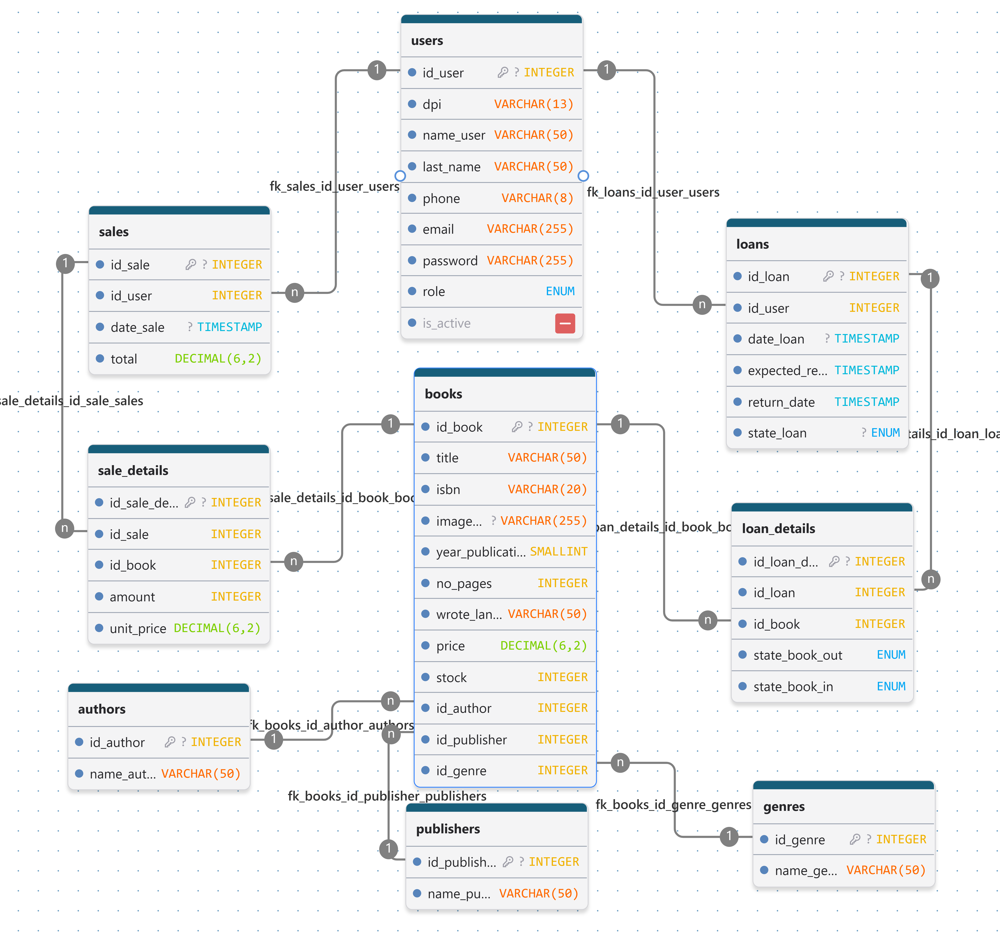

# Minerva Lib — Backend

API REST para la plataforma de gestión de una biblioteca y librería. El backend administra
el catálogo, las cuentas y las operaciones de préstamos y ventas; utiliza MySQL para guardar
los datos y Docker Compose para facilitar el entorno de desarrollo.

## Objetivo

Proveer los servicios que permiten consultar y mantener libros, autores, editoriales y géneros;
autenticar usuarios y administrar sus perfiles; y registrar préstamos, devoluciones y ventas,
manteniendo el inventario y el historial de operaciones.

## Funcionalidades

- Registro, inicio y cierre de sesión con autenticación basada en JWT.
- Perfiles de usuario y permisos diferenciados para usuarios y administradores.
- Gestión del catálogo de libros, autores, editoriales y géneros.
- Registro de préstamos y devoluciones, con estados de conservación de los libros.
- Registro de ventas y sus detalles.
- Validación de solicitudes, control de acceso, CORS y limitación de solicitudes.
- Esquema, datos de ejemplo, procedimientos y triggers de MySQL.

## Tecnologías

| Tecnología | Uso |
| --- | --- |
| Node.js y Express 5 | Servidor HTTP y API REST. |
| MySQL 8 y mysql2 | Persistencia y acceso a la base de datos. |
| Docker Compose | Ejecución coordinada de la API y MySQL. |
| JWT, Passport y bcrypt | Autenticación, autorización y protección de contraseñas. |
| express-validator | Validación de parámetros y cuerpos de solicitudes. |
| Bruno | Colección de solicitudes para explorar y probar la API. |

## Modelo de base de datos

El diagrama muestra las entidades principales y sus relaciones en MySQL.



Consulta [database/README.md](./database/README.md) para ver el detalle de las tablas,
cardinalidades y reglas de negocio.

## Estructura del proyecto

```text
.
├── bruno/                  # Colección Bruno y entorno local
├── database/
│   ├── diagram/            # Diagrama actualizado de la base de datos
│   ├── 01-schema.sql       # Esquema y relaciones
│   ├── 02-seeds.sql        # Datos de ejemplo
│   ├── 03-procedures-triggers.sql
│   └── README.md           # Tablas, relaciones y reglas de la base de datos
├── src/
│   ├── config/             # Configuración de entorno, BD, JWT y versión
│   ├── controllers/        # Controladores HTTP
│   ├── dtos/               # Formatos de salida
│   ├── middlewares/        # Autenticación, validación y errores
│   ├── models/             # Consultas y acceso a datos
│   ├── routes/             # Rutas de la API
│   ├── services/           # Lógica de negocio
│   ├── utils/              # Utilidades
│   ├── validators/         # Reglas de validación
│   ├── app.js              # Configuración de Express
│   └── server.js           # Inicio y conexión del servidor
├── .env.example            # Plantilla de configuración local
├── docker-compose.yml
├── Dockerfile
├── package.json
└── README.md
```

## Requisitos

- Docker y Docker Compose, o bien Node.js 18 o posterior y una instancia de MySQL 8.
- Un secreto JWT propio de al menos 32 caracteres.

## Inicio rápido con Docker

1. Crea el archivo de entorno desde la plantilla:

   ```bash
   cp .env.example .env
   ```

2. Genera un secreto JWT y asígnalo a `JWT_SECRET` en `.env`:

   ```bash
   node -e "console.log(require('crypto').randomBytes(48).toString('base64url'))"
   ```

3. En `.env`, reemplaza las credenciales de ejemplo por valores apropiados para tu entorno.
   Conserva `DB_HOST=db` para la ejecución con Docker Compose.
4. Construye e inicia la API y la base de datos:

   ```bash
   docker compose up --build -d
   ```

Docker ejecuta los scripts SQL de `database/` en orden alfabético **solo al inicializar un
volumen de base de datos vacío**. La API queda disponible en `http://localhost:5000` y el
endpoint de salud en `http://localhost:5000/api/v1/health` con la configuración predeterminada.

Para detener los contenedores sin borrar los datos:

```bash
docker compose down
```

> **Atención:** `docker compose down -v` elimina también el volumen y los datos de MySQL.
> Úsalo solo cuando quieras reinicializar la base de datos desde cero.

## Desarrollo sin Docker para la API

Puedes usar una instancia local de MySQL o iniciar solo la base de datos con Docker Compose.
En este último caso, configura en `.env` `DB_HOST=127.0.0.1` y `DB_PORT=3307` (el puerto
publicado predeterminado). Luego instala las dependencias e inicia el servidor:

```bash
npm install
npm run dev
```

Para iniciar sin nodemon:

```bash
npm start
```

## API

El prefijo predeterminado es `/api/v1`. El proceso valida al arrancar que el número mayor de
la versión SemVer en `package.json` corresponda al major del prefijo de `API_PREFIX`; por
ejemplo, `1.2.3` requiere `/api/v1`. Al cambiar el major, actualiza `API_PREFIX` en `.env`.

| Recurso | Rutas principales | Acceso |
| --- | --- | --- |
| Salud | `GET /health` | Público |
| Autenticación | `POST /auth/register`, `POST /auth/login`, `POST /auth/logout` | Público |
| Perfil y usuarios | `/users` y `/users/me` | Autenticación; administración para gestión y reactivación de usuarios |
| Libros, autores, editoriales y géneros | `/books`, `/authors`, `/publishers`, `/genres` | Consulta pública; cambios para administrador |
| Préstamos | `GET /loans`, `GET /loans/me`, `POST /loans`, `PUT /loans/:id/approve`, `PUT /loans/:id/reject`, `PUT /loans/:id/return-request`, `PUT /loans/:id/return` | Usuario: solicita préstamo/devolución y ve su historial; admin: revisa solicitudes, registra entrega/devolución y ve todo el historial |
| Compras | `GET /sales`, `GET /sales/me`, `POST /sales`, `PUT /sales/:id/confirm`, `PUT /sales/:id/reject` | Usuario: solicita compra y ve su historial; admin: verifica pago, confirma/rechaza y ve todo el historial |

Las rutas de la tabla son relativas al prefijo: por ejemplo, `GET /api/v1/books`. Las cuentas
se desactivan sin borrar su historial. Consulta [database/README.md](./database/README.md)
para el detalle del esquema y las reglas de negocio. La colección de Bruno está en
[`bruno/minerva-lib`](./bruno/minerva-lib).

## Configuración

La aplicación carga `.env` al iniciar. Las variables principales se documentan en
[.env.example](./.env.example):

| Variable | Descripción |
| --- | --- |
| `PORT` | Puerto HTTP de la API (predeterminado: `5000`). |
| `API_PREFIX` | Prefijo versionado de la API (predeterminado: `/api/v1`). |
| `DB_HOST`, `DB_PORT` | Host y puerto de MySQL; Compose usa `db:3306`. |
| `DB_USER`, `DB_PASSWORD`, `DB_NAME` | Credenciales y nombre de la base de datos. |
| `JWT_SECRET`, `JWT_EXPIRES_IN` | Secreto y duración de los tokens. |
| `CORS_ORIGIN` | Orígenes permitidos, separados por comas; vacío permite cualquier origen. |
| `RATE_LIMIT_WINDOW_MS`, `RATE_LIMIT_MAX_REQUESTS` | Ventana y máximo de solicitudes por ventana. |

No publiques `.env` ni uses las credenciales de ejemplo en producción. Configura secretos,
CORS, credenciales de MySQL y límites de solicitudes según el entorno de despliegue.

## Autoría y licencia

- **Creador:** [Anderson-Oloroso](https://github.com/Anderson-Oloroso).
- **Licencia:** ISC. Consulta [LICENSE](./LICENSE).
