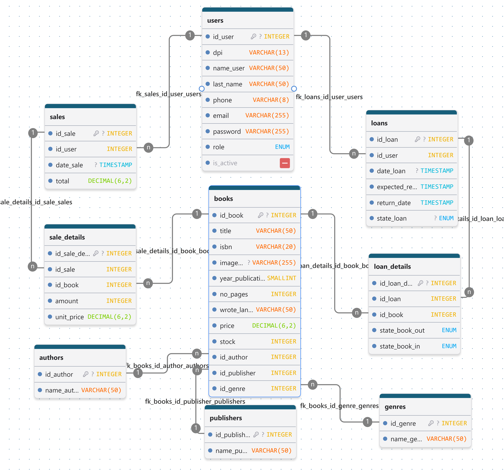

# Base de datos Minerva Lib

La base de datos `minerva_lib_db` gestiona el catálogo de libros, usuarios, préstamos y ventas. Está diseñada para MySQL 8 y se define en `01-schema.sql`.

## Tablas y campos

`PK` = clave primaria; `FK` = clave foránea; `NULL` = opcional.

| Tabla | Campos |
| --- | --- |
| `authors` | `id_author` INT PK; `name_author` VARCHAR(50). |
| `publishers` | `id_publisher` INT PK; `name_publisher` VARCHAR(50). |
| `genres` | `id_genre` INT PK; `name_genre` VARCHAR(50). |
| `books` | `id_book` INT PK; `title` VARCHAR(50); `isbn` VARCHAR(20); `year_publication` SMALLINT UNSIGNED; `no_pages` INT; `wrote_language` VARCHAR(50); `price` DECIMAL(6,2); `stock` INT; `id_author` INT FK NULL; `id_publisher` INT FK NULL; `id_genre` INT FK. |
| `users` | `id_user` INT PK; `dpi` VARCHAR(13); `name_user` VARCHAR(50); `last_name` VARCHAR(50); `phone` VARCHAR(8); `email` VARCHAR(255) UNIQUE; `password` VARCHAR(255); `role` ENUM('user','admin'); `is_active` BOOLEAN. |
| `loans` | `id_loan` INT PK; `id_user` INT FK; `date_loan` TIMESTAMP; `expected_return_date` TIMESTAMP; `return_date` TIMESTAMP NULL; `state_loan` ENUM('activo','devuelto'). |
| `loan_details` | `id_loan_detail` INT PK; `id_loan` INT FK; `id_book` INT FK; `state_book_out` ENUM('Excelente','Regular','Maltratado'); `state_book_in` ENUM('Excelente','Regular','Maltratado') NULL. |
| `sales` | `id_sale` INT PK; `id_user` INT FK; `date_sale` TIMESTAMP; `total` DECIMAL(6,2). |
| `sale_details` | `id_sale_details` INT PK; `id_sale` INT FK; `id_book` INT FK; `amount` INT; `unit_price` DECIMAL(6,2). |

## Cardinalidades

| Relación | Cardinalidad | Significado |
| --- | --- | --- |
| `authors` — `books` | Autor 0..N; libro 0..1 | Cada libro puede tener cero o un autor registrado; un autor puede asociarse con varios libros. |
| `publishers` — `books` | Editorial 0..N; libro 0..1 | Cada libro puede tener cero o una editorial; una editorial puede publicar varios libros. |
| `genres` — `books` | Género 0..N; libro 1 | Cada libro requiere un género; un género puede clasificar varios libros. |
| `users` — `loans` | Usuario 0..N; préstamo 1 | Cada préstamo pertenece a exactamente un usuario. |
| `loans` — `loan_details` | Préstamo 1..N; detalle 1 | Cada préstamo incluye uno o más detalles; cada detalle pertenece a un préstamo. |
| `books` — `loan_details` | Libro 0..N; detalle 1 | Cada detalle de préstamo se refiere a un libro; el libro puede aparecer en distintos préstamos. |
| `users` — `sales` | Usuario 0..N; venta 1 | Cada venta pertenece a exactamente un usuario. |
| `sales` — `sale_details` | Venta 1..N; detalle 1 | Cada venta incluye uno o más detalles; cada detalle pertenece a una venta. |
| `books` — `sale_details` | Libro 0..N; detalle 1 | Cada detalle de venta se refiere a un libro; el libro puede venderse muchas veces. |

`loans`/`loan_details` y `sales`/`sale_details` separan los datos generales de cada operación de sus libros. Así, cada detalle funciona como vínculo entre el encabezado y un libro.



## Reglas principales

- `users.email` es único. El DPI debe tener 13 caracteres y el teléfono 8; el esquema no impone unicidad para el teléfono.
- `users.is_active` permite dar de baja una cuenta sin eliminar su historial; los usuarios inactivos no pueden iniciar sesión.
- `loans.state_loan` puede ser `activo` o `devuelto`. Al crear un préstamo, la fecha real de devolución y el estado de entrada de cada libro son `NULL`.
- El estado de conservación de cada libro puede ser `Excelente`, `Regular` o `Maltratado`.
- `books.price` es el precio actual. `sale_details.unit_price` conserva el precio aplicado en esa venta aunque luego cambie el precio del catálogo.
- El stock se descuenta al prestar o vender un libro y se repone al completar su devolución.

## Rutas de autenticación y usuarios

| Método y ruta | Permiso | Acción |
| --- | --- | --- |
| `POST /auth/register` | Público | Registrar una cuenta con rol `user`. |
| `POST /auth/login` | Público | Iniciar sesión. |
| `GET /users/me` | Usuario autenticado | Consultar el propio perfil. |
| `PUT /users/me` | Usuario autenticado | Actualizar sus datos; no puede cambiar su rol. |
| `DELETE /users/me` | Usuario autenticado | Desactivar su propia cuenta; conserva préstamos y ventas. |
| `GET /users` | Admin | Listar usuarios. |
| `POST /users` | Admin | Crear un usuario. |
| `GET /users/:id` | Admin | Consultar un usuario. |
| `PUT /users/:id` | Admin | Actualizar datos, rol o estado de la cuenta. |
| `DELETE /users/:id` | Admin | Desactivar una cuenta sin borrar su historial. |

## Triggers

Los triggers están definidos en `03-procedures-triggers.sql` y ejecutan reglas de inventario automáticamente al insertar detalles o cambiar el estado de un préstamo.

| Trigger | Cuándo se ejecuta | Qué hace |
| --- | --- | --- |
| `trg_before_insert_loan_detail` | Antes de insertar un detalle de préstamo | Descuenta una unidad del stock. Rechaza libros inexistentes o sin existencias; el descuento condicional protege frente a préstamos concurrentes. |
| `trg_before_insert_sale_detail` | Antes de insertar un detalle de venta | Verifica que la cantidad sea positiva y descuenta esa cantidad del stock. Rechaza libros inexistentes o con stock insuficiente. |
| `trg_after_update_loan_return` | Después de actualizar un préstamo | Cuando cambia de `activo` a `devuelto`, repone una unidad por cada detalle prestado. |

## Procedimientos almacenados

Los procedimientos agrupan las operaciones relacionadas dentro de transacciones. Si ocurre un error SQL, revierten los cambios y propagan el error.

### `sp_create_loan(p_id_user, p_expected_return_date, p_details)`

Crea el préstamo y sus detalles. `p_details` es un arreglo JSON con objetos que contienen `id_book` y `state_book_out`. Requiere al menos un detalle, valida los IDs y estados, y devuelve el `id_loan` creado. Al insertar cada detalle, el trigger correspondiente descuenta el stock.

### `sp_return_loan(p_id_loan, p_details)`

Registra la devolución de un préstamo activo. `p_details` debe incluir todos los objetos del préstamo con `id_loan_detail` y `state_book_in`, sin duplicados. Valida que cada detalle pertenezca al préstamo; luego guarda los estados de entrada y marca el préstamo como `devuelto` con la fecha actual. Ese cambio activa el trigger que repone el stock.

### `sp_create_sale(p_id_user, p_details)`

Crea la venta y sus detalles. `p_details` es un arreglo JSON con objetos que contienen `id_book` y `amount`. Requiere al menos un libro, valida los datos, obtiene el precio actual desde `books.price`, lo copia en `sale_details.unit_price`, calcula `sales.total` y devuelve el ID y el total. El trigger de venta valida y descuenta las existencias.

## Inicialización y reinicio

Al iniciar MySQL con un volumen vacío, Docker Compose ejecuta los scripts SQL directamente dentro de `database/` en orden alfabético:

1. `01-schema.sql`: crea las tablas.
2. `02-seeds.sql`: carga datos de ejemplo.
3. `03-procedures-triggers.sql`: crea los triggers y procedimientos.

### Credenciales de los datos de ejemplo

Estas credenciales son únicamente para desarrollo y pruebas locales; no las uses en producción.

| Rol | Correos | Contraseña |
| --- | --- | --- |
| Admin | `admin@minerva.com`, `soporte.admin@minerva.com` | `@User/809--` |
| Usuario | `juan.perez@gmail.com`, `ana.gomez@gmail.com`, `carlos.estrada@gmail.com`, `maria.castillo@gmail.com`, `luis.morales@gmail.com`, `gabriela.santos@gmail.com`, `jorge.ramirez@gmail.com`, `claudia.ortiz@gmail.com`, `kevin.hernandez@gmail.com`, `valeria.diaz@gmail.com` | `@User/809--` |

Las contraseñas se guardan como hashes bcrypt en `02-seeds.sql`. Todas las cuentas de ejemplo comparten la contraseña indicada. Los seeds se ejecutan automáticamente solo cuando MySQL inicializa un volumen vacío.

Para iniciar los servicios:

```bash
docker compose up --build -d
```

Para inspeccionar las tablas:

```sql
USE minerva_lib_db;
SHOW TABLES;
SELECT id_user, name_user, email, role FROM users;
```

Para reiniciar la base desde cero y volver a cargar el esquema, los seeds, los triggers y los procedimientos:

```bash
docker compose down -v
docker compose up --build -d
```

**Advertencia:** `docker compose down -v` elimina permanentemente los datos guardados en el volumen de MySQL.
